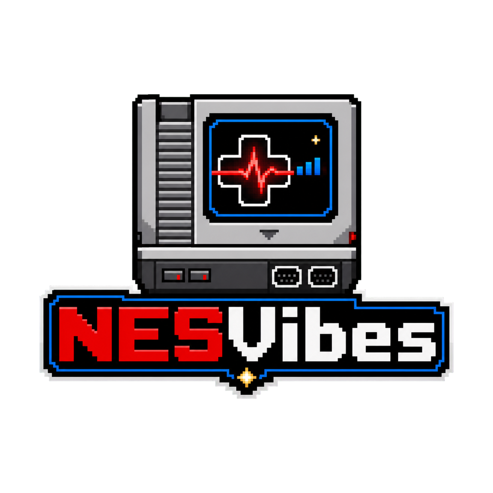

<p align="center">
  
  <br />
  <!-- repo-tagline:start -->
  <strong>🎮 Play NES homebrew and public-domain games in your browser 🕹️</strong>
  <!-- repo-tagline:end -->
</p>

NESVibes plays NES homebrew and public-domain games in your browser. Choose
a bundled game or drop your own compatible `.nes` file onto the stage.

## Play

Open the [live player](https://nesvibes.tsilva.eu) and select a game. Use
arrow keys to move, Z for B, X for A, Enter for Start, and Shift for Select.
Touch controls and fullscreen are available.

## Run locally

From the checkout:

```bash
pnpm install --frozen-lockfile --ignore-scripts
pnpm dev --port auto
```

Open the printed local URL.

[NESVibes development and compatibility guide](docs/nesvibes-guide.md).

## License

[MIT License](LICENSE). Bundled ROMs retain their own notices under `static/roms`.
